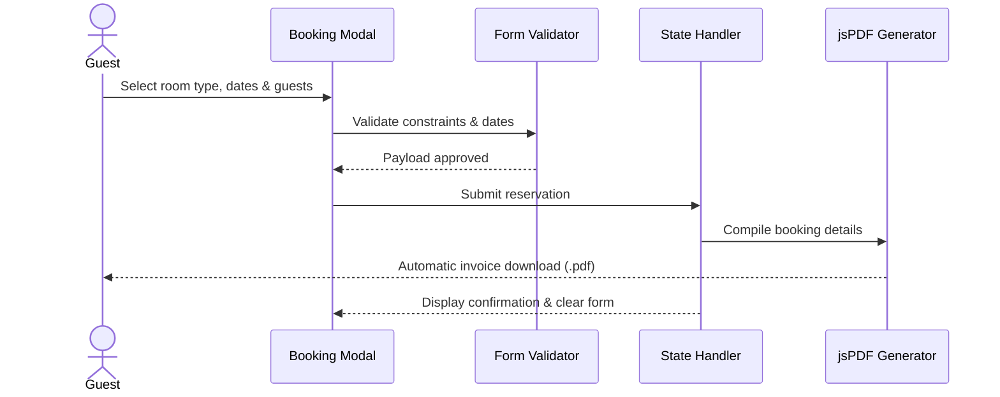

<div align="center">
  <picture>
    <source media="(prefers-color-scheme: dark)" srcset="src/assets/logo-dark.svg">
    <source media="(prefers-color-scheme: light)" srcset="src/assets/logo-light.svg">
    
  </picture>

  <h1>VERTEX</h1>

  <p><strong>A bespoke digital sanctuary for a modern coastal resort, crafted to make exploring suites, planning wellness retreats, and booking reservations feel effortless and refined.</strong></p>

  <p>
    <a href="https://vertex-luxury-resort.vercel.app/"><strong>Explore Live Site →</strong></a>
  </p>

  <p>
    
    
    
    
  </p>
</div>

---

## Table of Contents

- [Overview](#overview)
- [Key Features](#key-features)
- [Reservation & Invoice Flow](#reservation--invoice-flow)
- [Project Structure](#project-structure)
- [Tech Stack](#tech-stack)
- [Getting Started](#getting-started)
- [Roadmap](#roadmap)
- [License](#license)
- [Author](#author)

---

## Overview

Most luxury hospitality websites are weighed down by heavy assets, clunky third-party booking widgets, and slow page transitions that frustrate guests before they even arrive.

**Vertex** approaches resort booking from a clean-slate engineering perspective: delivering an editorial, magazine-like feel without sacrificing speed. Built with modern React and TypeScript, it keeps client interactions snappy, loads typography instantly without layout shift, and provides guests with an immediate, validated booking experience directly in their browser.

---

## Key Features

- **Architectural Storytelling**: Fluid scroll-tracked layout highlighting resort suites, ocean gastronomy, and wellness treatments with zero UI stutter.
- **Dynamic Booking Engine**: A modal-based reservation system managing both stay dates and guest counts with strict client-side validation using **Zod** and **React Hook Form**.
- **In-Browser PDF Invoices**: Generates a downloadable, branded PDF itinerary on successful reservation using **jsPDF**, requiring zero backend roundtrips.
- **Adaptive Glass Navigation**: A responsive header that maintains legibility across dark photography and light scroll sections without visual flicker.
- **Fast First Paint**: Fonts preconnected via Google Fonts and vector assets tailored with native SVG color-scheme adaptation.

---

## Reservation & Invoice Flow

The booking lifecycle runs client-first to keep user interactions instantaneous:



---

## Project Structure

The project uses a clean, feature-aligned layout matching real app routes and shared primitives:

```text
vertex-luxury-resort/
├── public/
│   └── favicon.svg           # Adaptive browser tab icon
├── src/
│   ├── assets/               # Brand vectors and optimized webp photography
│   ├── components/           # Core layout sections (Navbar, Hero, BookingModal, Footer)
│   │   └── ui/               # Headless interface primitives (Radix UI / shadcn)
│   ├── hooks/                # Viewport and interaction helpers
│   ├── lib/                  # Utility functions and jsPDF menu/invoice generators
│   └── pages/                # Route views (Accommodations, DiningMenu, Wellness, etc.)
├── index.html                # Preconnected typography and LCP preloads
├── tailwind.config.ts        # Custom resort color tokens and typography definitions
└── vite.config.ts            # Build configuration
```

---

## Tech Stack

- **Core**: React 18, TypeScript, Vite
- **Styling**: Tailwind CSS, shadcn/ui headless primitives
- **Forms & Validation**: React Hook Form, Zod
- **Data & State**: TanStack React Query v5
- **Document Generation**: jsPDF
- **Routing & Icons**: React Router DOM v6, Lucide React

---

## Getting Started

### 1. Prerequisites
Ensure you have **Node.js 18+** installed on your machine.

### 2. Clone and Install
```bash
git clone https://github.com/abdul-rahman-0x/vertex-luxury-resort.git
cd vertex-luxury-resort
npm install
```

### 3. Run Locally
```bash
npm run dev
```

The application will be running at `http://localhost:5173`.

---

## Roadmap

- [ ] Connect a Node.js/Express REST API to persist live room availability.
- [ ] Add PostgreSQL integration via Prisma for dynamic pricing calculations.
- [ ] Expand the guest dashboard for managing previous and upcoming stays.

---

## License

Distributed under the [MIT License](LICENSE).

---

## Author

Crafted by **[Abdul Rahman](https://github.com/abdul-rahman-0x)**
